<a href="https://velox-car-ad.vercel.app">
  
</a>

  <a href="https://velox-car-ad.vercel.app"><b>▶ Open the live site — velox-car-ad.vercel.app</b></a>
  &nbsp;·&nbsp; <a href="docs/how-it-works.md">How it works</a>
  &nbsp;·&nbsp; <a href="docs/how-it-was-built.md">How it was built</a>

  
  
  
  

**VELOX** is a dark automotive landing page with three performance machines. Each model page has a scroll-driven 3D hero: scrolling plays the machine's 3D animation frame by frame, and scrolling back rewinds it.

This repository holds the site's **assets**, **screenshots**, and documentation on **how it was built** and **how it works**.

---

## 🏎️ The machines, in motion

These are the real 3D frame sequences that play on each hero as you scroll.

| GT-X · Supercar | RS1 · Moto Racer | LX1 · Hypercar |
|:---:|:---:|:---:|
|  |  |  |
| Twin-turbo V8 · 750 HP · 0–60 in 2.8s | Inline-four · 220 HP · 312 km/h | Hybrid V12 · 1200 HP · 0–60 in 1.9s |
| [Open /car ↗](https://velox-car-ad.vercel.app/car) | [Open /moto ↗](https://velox-car-ad.vercel.app/moto) | [Open /legend ↗](https://velox-car-ad.vercel.app/legend) |

## 📸 Screenshots

All captured from the live site at 1440×900; mobile at 390×844.

| | |
|:---:|:---:|
| 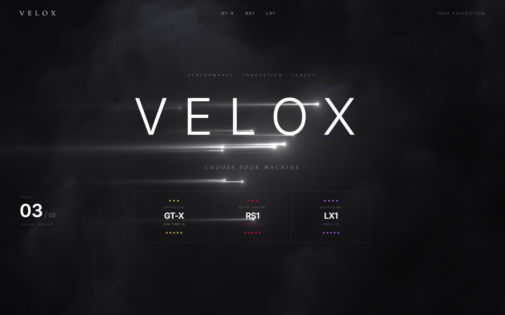 **Landing:** WebGL light-streak hero and model selector | 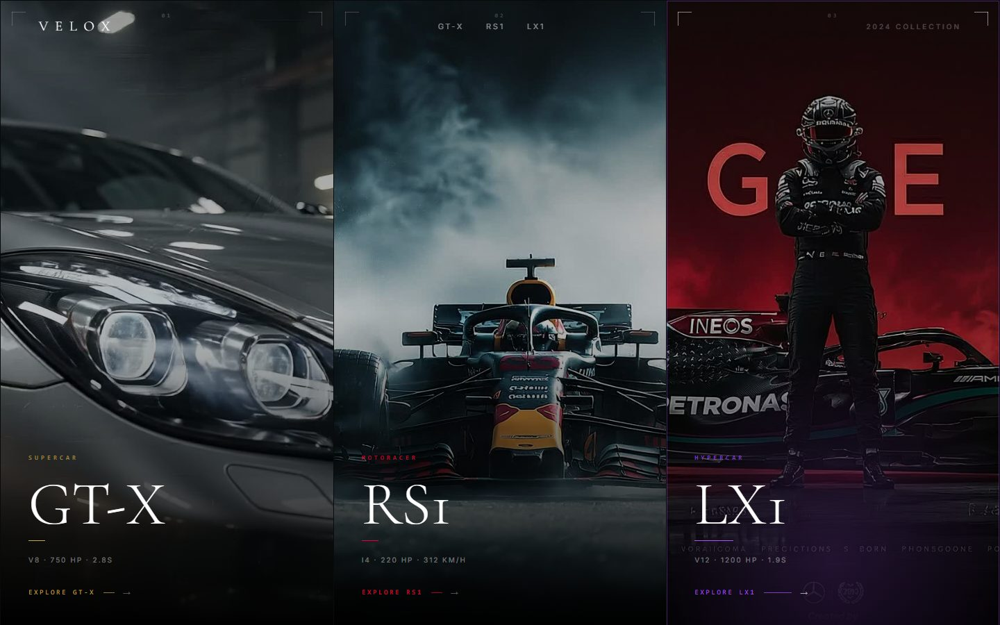 **Model cards:** hover zoom and accent glow |
| 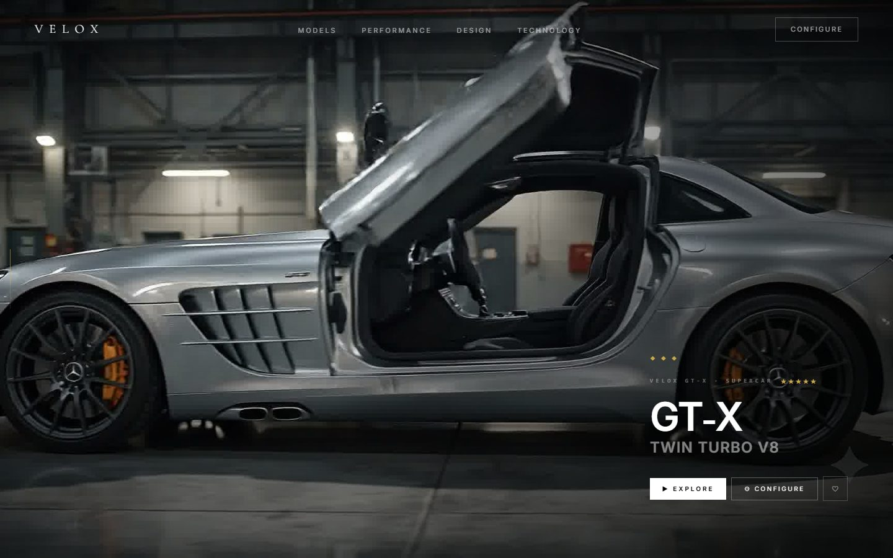 **GT-X hero:** mid-scroll, doors opening | 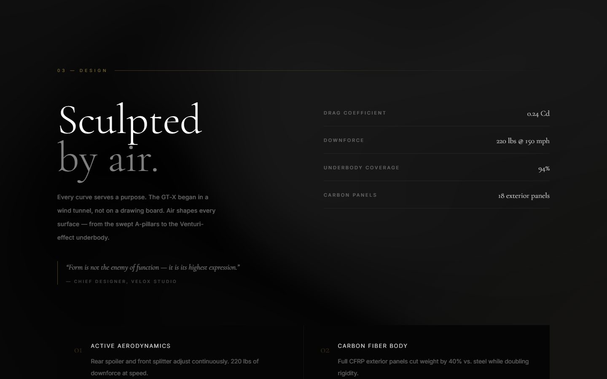 **GT-X:** Design section |
| 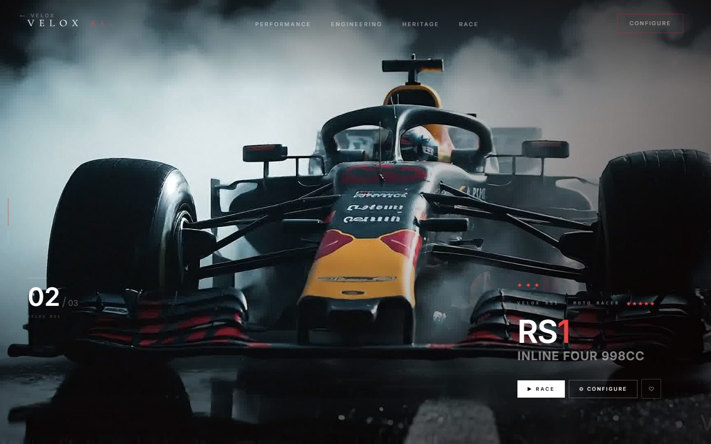 **RS1 hero:** mid-scroll | 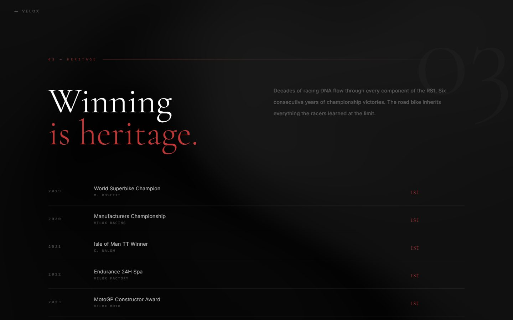 **RS1:** Heritage |
| 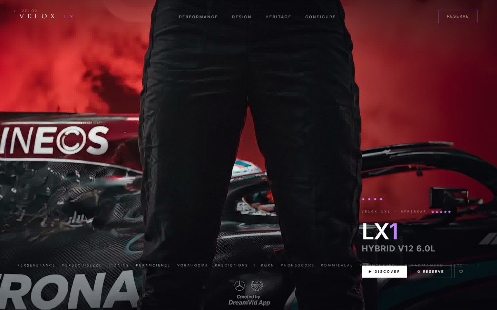 **LX1 hero:** mid-scroll | 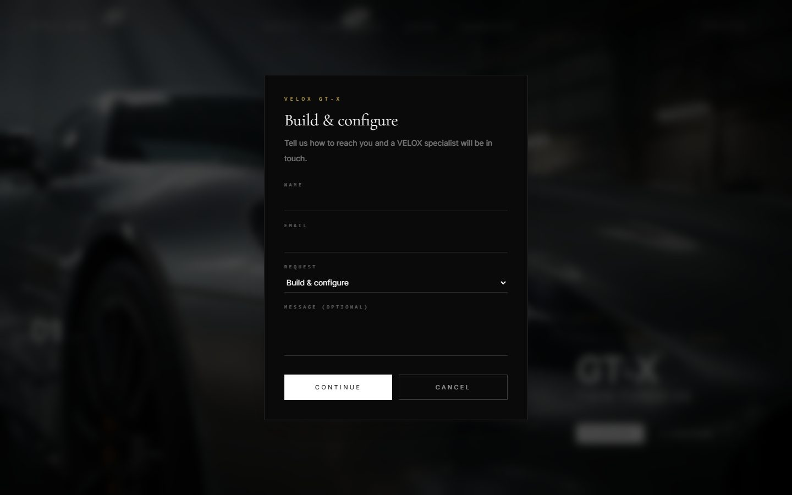 **Enquiry form:** Configure / Reserve / Book |

  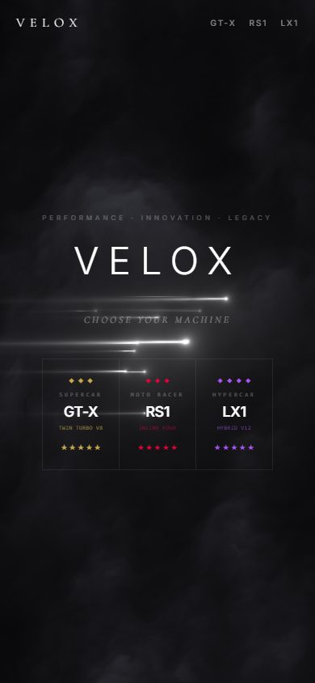
  &nbsp;&nbsp;
  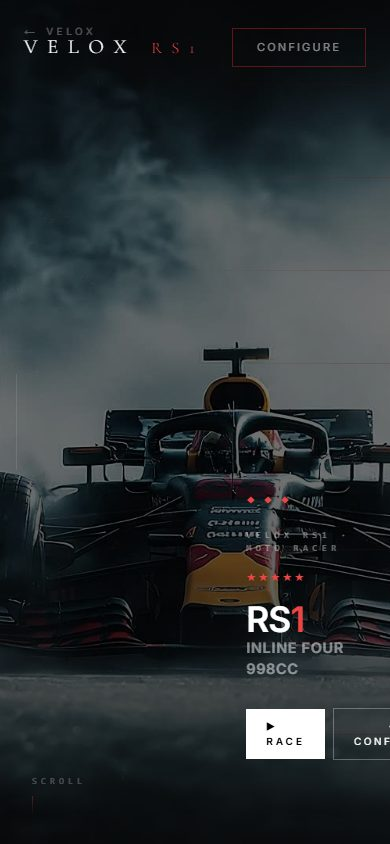

[`screenshots/comparison`](screenshots/comparison) has side-by-side captures of the original site (left) and this build (right) at the same viewport and scroll position.

## ⚙️ How it works (short version)

- **Scroll-driven 3D heroes:** each model's 215–240 frames preload behind a loader and decode to bitmaps. GSAP ScrollTrigger maps a 6000px scroll onto those frames, drawn on a sticky canvas.
- **Smooth scrolling:** Lenis inertial scrolling, synced to the frame scrub, so the car moves fluidly instead of jumping per wheel click.
- **Live shaders:** a hand-written WebGL2 light-streak shader on the landing page, and mesh-gradient backgrounds on every section. Both pause offscreen and scale down on slower GPUs, holding about 60fps on integrated graphics.
- **Working actions:**
  - Configure / Reserve / Book open an enquiry form.
  - ♡ saves a favourite.
  - Every nav and footer link has a real destination.

Full details: [**docs/how-it-works.md**](docs/how-it-works.md).

## 🛠️ How it was built (short version)

1. The original VELOX site was inspected at desktop and mobile sizes: fonts, colours, positions and every interaction.
2. It was rebuilt in **Next.js 16 · React 19 · TypeScript · Tailwind CSS v4**, using the original images and frame sequences unchanged.
3. Source and rebuild were captured side by side until every section lined up to the pixel at 1440px.
4. Lint, type-check, production build and a 45-step click test all pass. The site is deployed on **Vercel**.

Full details: [**docs/how-it-was-built.md**](docs/how-it-was-built.md), plus the measurement notes in [docs/research-brief.md](docs/research-brief.md).

## 📁 What's in this repository

| Path | Contents |
|---|---|
| [`assets/`](assets) | Model card images (`gt-x.jpg`, `rs1.jpg`, `lx1.jpg`) and the 695 hero frames under `assets/frames/{gt-x,rs1,lx1}/` (1920×1080 JPG) |
| [`media/`](media) | The animated README banner and the frame-sequence previews |
| [`screenshots/live/`](screenshots/live) | Screenshots of the deployed site |
| [`screenshots/comparison/`](screenshots/comparison) | Original vs rebuild, side by side |
| [`docs/`](docs) | How it works, how it was built, research brief |

> The application source code isn't in this repository; it holds only assets, screenshots and documentation. The live build is at **[velox-car-ad.vercel.app](https://velox-car-ad.vercel.app)**.
